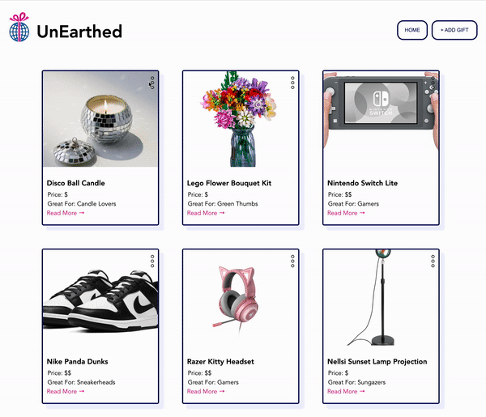

# Lab 4: Unearthed Part 4 Exemplar

## Overview

In the fourth and final iteration of Unearthed, students add support for creating, updating, and deleting gifts via the API.

## Project Screenshot



## Setup

### Dependencies

* [Vite](https://vitejs.dev/guide/)
* [React](https://www.npmjs.com/package/react)
* [React DOM](https://www.npmjs.com/package/react-dom)
* [React Router](https://www.npmjs.com/package/react-router)
* [Express](https://expressjs.com/)
* [PostgreSQL](https://www.npmjs.com/package/pg)
* [Nodemon](https://www.npmjs.com/package/nodemon)
* [CORS](https://www.npmjs.com/package/cors)

---

### Install Dependencies

Before installing dependiencies, you will need `node` and `npm` installed globally on your machine by installing  [NodeJS](https://nodejs.org/en/download/) onto your machine.

To install the dependencies for the client-side, run the following command in the `client` directory:

```sh
npm install
```

Alternatively, you can install the client-side dependencies individually:

```sh
npm install react
npm install react-dom
npm install react-router-dom
npm install vite@latest
```

To install the dependencies for the client-side, run the following command in the `server` directory:

```sh
npm install
```

Alternatively, you can install the client-side dependencies individually:

```sh
npm install express
npm install nodemon
npm install pg
npm install cors
```

---

### Run UnEarthed Part 4

In the `server` directory, run the following in your terminal:

```sh
npm run start

```

In the `client` directory, run the following in your terminal:

```sh
npm run dev

```

Visit the web application in the browser:

```html
http://localhost:5173/
```
